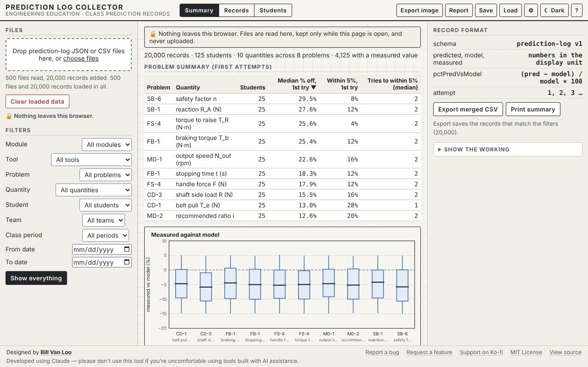

# Prediction Log Collector

A teacher tool for the class's prediction records. Every Engineered by the Numbers tool asks students to predict before it shows the answer, and keeps a log of each prediction. The Collector merges those logs from a whole class, across every tool, and shows how close students get, where they struggle, and whether they improve with attempts.

Part of **[Engineered by the Numbers](https://github.com/billvanloo/EngineeredByTheNumbers)**, a Principles of Engineering unit (all modules).



## Quick start

**Online:** enable GitHub Pages for this repo (Settings → Pages → Deploy from a branch → `main`, `/ (root)`) and share the URL.

**Offline:** download `index.html` and open it in any current browser. It's one self-contained file with no network calls, and works on a Chromebook.

**Nothing leaves the browser.** Files are read on the teacher's computer and kept only while the page is open. Nothing is uploaded, and the records are not saved in the browser.

## Collecting the logs

In any of the tools, students press **Log**, then **Export CSV** or **Export JSON**, and hand in the file. Or they press **Copy last row** and paste it into a shared Google Sheet, which you then download as CSV. Drop any number of files onto the Collector, or press **Choose files**.

- Files that can't be read are listed with the reason (not valid JSON, another kind of file, and so on). The rest still load.
- Files from a newer tool version load their known fields, with a warning.
- Exact duplicates (same student, tool, problem, quantity, attempt and time) are removed, so loading the same file twice does no harm.
- A CSV saved back from Google Sheets reads without loss: blank rows are skipped and Sheets' date format is turned back into ISO time.

## What it shows

- **Filters:** unit module, tool, problem, quantity, student, team, class period, and a date range. Records carry no module, so the Module filter uses each tool's modules (see Teacher notes).
- **Summary tab.** One row per problem and quantity:
  - median % off on the first try (the sign dropped),
  - the share of students within 5% on the first try,
  - the median number of tries to get within 5%, and how many students haven't yet.

  Below it, **Measured against model**: for records with a lab measurement, how far the measurement is from the model, by problem. This is where friction and efficiency show up. Large groups are drawn as a box (the middle half) instead of dots.
- **Records tab.** Every record, 100 rows to a page.
- **Students tab.** Each student's problems, their median % off on the first try, and a small trend line of first tries over time, with a word for the trend (closer, further off, about the same, too few to tell).
- **Show the working** walks through the top row of the summary: one record's percent difference, the sorted first tries and their median, the within-5% count, and the tries to within 5%.
- Every table sorts by any column, with the mouse or the keyboard (Tab to the heading, Enter).
- **Export merged CSV** saves the records that match the filters, in the shared prediction-log format, so the merged file loads back into the Collector or a spreadsheet. **Print summary** prints the summary and student tables.

**Why medians.** Every summary uses the median, not the mean. One wild guess, such as rpm typed where rad/s belonged and 900% off, would drag a mean a long way. The median stays with the middle of the class. The help panel explains this too.

## Teacher notes

- **Modules by tool** (QUESTIONS Q27 asks whether the log should carry a module field):

  | Tool | Modules |
  |---|---|
  | Truss Stress Visualizer | 0, 2, 4, 5 |
  | Motor and Drive Matcher, Gear Train Workbench | 1, 5 |
  | Friction and Screw Lab | 2 |
  | Flywheel Brake Lab | 3 |
  | Shaft and Beam Workbench | 4, 5 |
  | Conveyor Designer | 5 |
  | Units and Formula Checker | all |

- **Loaded data is not kept** (QUESTIONS Q28). Save keeps your filters, sort and tab, not the records. Use Export merged CSV to keep a merged file. A saved filter whose value isn't in the loaded files is shown as "(not in the loaded files)", so the view is never filtered without you seeing it.
- **Percent differences are recomputed** from each record's numbers when a file is read, so a hand-edited spreadsheet can't carry a wrong percentage. Records with no model value (model 0) are counted but left out of the medians.
- **Size:** 500 files and 20,000 records load, summarize and draw in about a third of a second in a desktop browser (`docs/screenshots/perf.txt`).

## How it connects to the other tools

| File | Direction |
|---|---|
| `prediction-log` JSON/CSV from every tool | **In** |
| merged `prediction-log` CSV | **Out**, to a spreadsheet or back into the Collector |

## Development

```
node dev/test.js          # 43 checks: spec cases PL-6 to PL-11, the summaries, filters, sorting
node dev/verify-html.js   # inline code in index.html matches dev/core.js and dev/vendor/; runs spec cases on it
node dev/e2e.js           # 98 browser checks in headless Chromium (needs Playwright, see below)
```

- **Where the code lives.** `dev/core.js` holds the loading, merging, filters and summaries. `dev/fixtures/generate.js` makes a seeded test class (500 files, 20,000 records). `dev/vendor/` holds the shared Engineered by the Numbers tool shell, prediction log, file schemas, statistics and plotting helpers. Don't edit vendored files here. Change them in the EngineeredByTheNumbers repo and run its `scripts/sync-vendor.js`.
- **Changing the core.** Edit `dev/core.js`, run `node dev/test.js`, then `node dev/verify-html.js --fix` to copy it into `index.html`.
- **Cross-tool check.** When the other tool repos sit next to this one, `dev/e2e.js` opens each, makes a prediction, exports its log, and loads them all here.
- **Playwright for the e2e checks.** It isn't a project dependency. Once, from the repo root: `npm i --no-save playwright && npx playwright install chromium`. You can also set `CHROMIUM_PATH` to an installed Chromium.

The spec this tool was built from is in [`docs/spec.md`](docs/spec.md), with the shared conventions in [`docs/conventions.md`](docs/conventions.md).

This was built using Claude. Please don't use this tool if you have qualms about using code created with AI tools.
